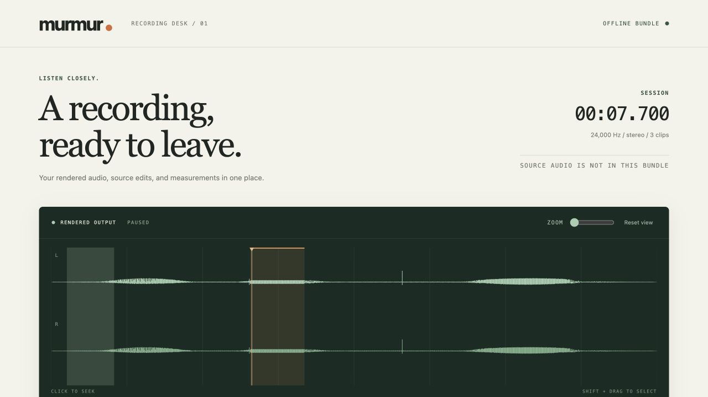

# murmur

Offline recording repair and source redaction, written in Scheme.

Cut a recording, remove a phrase everywhere it appears, repair the signal, and
inspect the exact audio you will publish. Removed native samples never reach the
resampler, master effects, waveform, or public source fingerprint.

[](https://github.com/Aneesh495/murmur/actions/workflows/verify.yml)



[Full desk view](docs/media/desk-full.jpg)

## Try it

You need **Guile 3, Make, and a C11 compiler** on macOS or Linux.
[Setup instructions](docs/development.md#toolchain).

```sh
git clone https://github.com/Aneesh495/murmur.git
cd murmur
make demo
```

Open `build/demo/review/review.html`. The demo generates all its audio locally:
harmonic pulses, hum, noise, isolated clicks, and a synthetic interval to remove.
There is no dataset, recorded voice, account, download, or audio device dependency.
An existing demo is verified rather than overwritten.

The desk plays the rendered WAV, shows source edits and signal measurements,
seeks to markers, loops selected ranges, and exports source-bound redaction
patches. Select with Shift + drag or type precise start/end times. Share only the
generated `review` directory; the synthetic originals stay beside `edit.mur`.

## A source edit, not an output mute

Resampling can spread one sample across neighboring output frames. Filters and
spectral windows can spread it further. Repeating a clip can introduce the same
phrase again. Murmur applies a redaction once, in native source coordinates,
before any of those operations.

Public identities follow the same rule. They hash canonical sanitized native
samples. Raw original-file fingerprints stay local. The acceptance suite changes
only forbidden input samples and requires **every byte of every exported file**
to stay identical, including HTML and receipts.

Write this as `edit.mur` after running the demo:

```scheme
(murmur
  (version 1)
  (rate 48000)
  (channels 2)
  (source field (path "build/demo/field.wav"))
  (redact field (from 2.75) (to 3.4)
          (mode tone) (guard 0.02) (hz 880) (level-db -24))
  (clip take (source field) (from 0.2) (to 8)
        (fade-in 0.02) (fade-out 0.05))
  (effect highpass (hz 80))
  (effect limit (ceiling-db -2))
  (marker (at 2.55) (label "Source redaction")))
```

```sh
bin/murmur render edit.mur build/my-review
bin/murmur verify build/my-review
bin/murmur explain edit.mur 122400
```

Documents use a bounded data grammar, not executable Scheme. Decimal timestamps
remain exact rationals until frame selection. Misspelled fields, conflicting
redactions, source changes, unsupported formats, resource overruns, and output above full scale fail before publication.

## Inside

| Part | Mechanism |
| --- | --- |
| Source boundary | Strict RIFF scanning, finite PCM decoding, guarded interval masks, sanitized four-page caches |
| Sampling | Rational sample positions, normalized Blackman-windowed sinc kernels, exact common polyphases, bounded phase interpolation |
| Timeline | Source-wide edits, arbitrary clip placement, repeated selections, overlap mixing, linear fades, equal-power mono pan |
| Repair | Stable RBJ biquads, stereo-linked soft-knee compression, hysteretic gating, sample limiting, isolated-click repair |
| Spectral path | Reusable radix-two FFT plans, weighted overlap-add, boundary reconstruction, frozen noise profiles |
| Review | Offline HTML waveform desk, typed selections, markers, pre-effect source mapping, source-bound patch download |
| Publication | Encoded-audio analysis, path-free edit maps, sanitized identities, strict manifests, no-replace directory publication |
| Concurrency | Inode/device/size and nanosecond timestamp checks around reads, final raw-digest checks, cancellation cleanup |

The audio algorithms, edit compiler, renderer, CLI, and reports are Scheme. A
small C adapter preserves filesystem nanoseconds that Guile's macOS `stat`
binding omitted. JavaScript draws the review desk; Python independently checks
published outputs. There is no external DSP library or codec subprocess.

## Use your own recording

```sh
make
bin/murmur init recording.wav edit.mur
# Edit the source intervals and clip settings in edit.mur.
bin/murmur render edit.mur build/review
```

To apply a patch downloaded from the desk:

```sh
bin/murmur apply-patch edit.mur patch.mur revised.mur
bin/murmur render revised.mur build/revised-review
```

New projects and output directories must not exist. Patches bind to the semantic
plan and every sanitized source identity. Imported interval labels can produce
the same patch format, with label text discarded.

See the [command reference](docs/commands.md),
[edit language](docs/language.md), and
[three runnable examples](examples/README.md).

## Verify it

```sh
make verify
```

Full verification additionally needs Python 3.10+ and Node 18+. It includes 72
Scheme cases in both interpreted and compiled modes, independent PCM and measurement checks, six whole-bundle privacy
pairs, negative controls, 303 malformed inputs, analytic signal checks, browser
arithmetic and HTML checks, native ABI canaries, real-process cancellation, and
the complete demo plus every example.

`build/verification.json` binds the raw reports to a source manifest that must
remain unchanged throughout the run. CI runs the battery on macOS and Linux and
preserves the reports. [Verification details](docs/verification.md) and the
[defect ledger](docs/defects.md) describe what failed during development and what
the checks do and do not establish.

[Recorded acceptance](docs/evidence/README.md) includes matching source manifests
and raw results from a fresh clone and both hosted platforms.

## Scope

Version 1 reads integer and floating PCM WAV, routes mono/stereo timelines, and
renders offline. Streaming effects support long bounded sessions; spectral and
other full-buffer effects have a stricter memory limit. Meters report sample
peak and unweighted RMS. The limiter controls sample peaks. There is no speech
recognition, loudness-standard compliance, true-peak control, or real-time audio
callback.

The redaction property applies to marked source samples, not identifying labels
or unmarked content. A manifest provides integrity, not authorship or encryption.
[Supported formats and resource limits](docs/limits.md).

## Navigate

- [Architecture and transaction diagrams](docs/architecture.md)
- [Privacy and identity domains](docs/privacy.md)
- [DSP equations and clock conventions](docs/numerics.md)
- [Developer guide and extension contracts](docs/development.md)
- [Verification and measurements](docs/verification.md)
- [Design decisions](docs/decisions.md)

`src/murmur/project` owns edit compilation, `src/murmur/wave` owns container and
PCM I/O, `src/murmur/dsp` owns signal processing, and `src/murmur/assets` owns the
review interface. `native` contains the metadata adapter. `tests` contains Scheme
regressions and independent command-driven checks.

MIT. [License](LICENSE).
