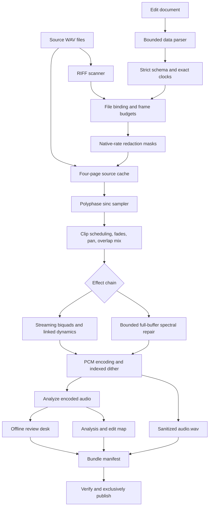
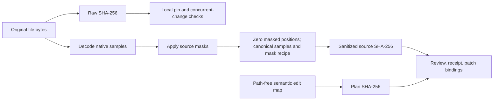
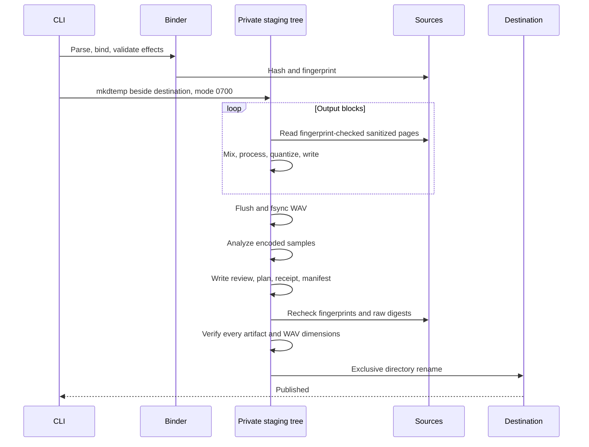

# Architecture

Murmur turns a data document and immutable source recordings into one publication
directory. The hardest ordering constraint is that redaction must precede every
operation that can spread a sample across time: interpolation, filtering,
compression envelopes, spectral windows, and repeated clips.

## Data path

The C adapter is outside the audio path. It exposes seven filesystem identity
words obtained from `fstat`. Scheme compares those words before and after page
reads. Publication calls the platform's exclusive rename primitive through
Guile's foreign interface.

## Representations

| Representation | Owner | Invariant |
| --- | --- | --- |
| Parsed data | `data.scm` | One bounded document; no evaluation or reader extensions |
| Edit records | `project/model.scm` | Schema-valid source, clip, redaction, and project fields |
| Bound source | `project/compile.scm` | Canonical path, scanned format, raw digest, sanitized identity, filesystem fingerprint |
| Compiled clip | `project/compile.scm` | Integral native source endpoints and integral output placement |
| Native page | `wave/stream.scm` | Planar doubles; all masks already applied |
| Output block | `mix.scm` | A precise interval of the output clock |
| Effect state | `effects.scm` | Fresh for each render; channel count and clock never change |
| Publication bundle | `bundle.scm` | Flat regular files, dimension-checked WAV, checked artifact hashes |

A project record has no open file descriptors. A bound plan has metadata but no
persistent raw audio buffers. A source reader owns its port and a fixed cache.
Those boundaries make cleanup and lifetime visible in the code.

## Binding phase

1. Resolve every source relative to the document's canonical parent directory.
2. Require regular files and reject repeated canonical paths.
3. Check the aggregate source byte budget before hashing or decoding.
4. Capture a filesystem fingerprint and scan the RIFF container.
5. Compute the raw file digest and verify an optional local pin.
6. Compile guarded source masks into sorted, disjoint intervals.
7. Compute the canonical identity of sanitized native samples.
8. Recheck the filesystem fingerprint.
9. Convert clip endpoints, placements, and fades into frame counts.
10. Reject source overruns, rounded zero-length clips, overlapping fades, and
    output/work-budget overruns.

Byte-identical source files must use one identifier. A source identifier is the
unit of redaction, so accidentally importing another copy of the same file under
an unredacted alias would be an unsafe editing surprise.

Effect schemas and biquad design are checked before staging output. Mixer setup
also checks channel routing and the aggregate resampling-table budget.

## Pulling a block

The mixer accepts an absolute output start and count. Each clip intersects that
interval with its own placement. A clip's local output index determines its
native source position by exact integer arithmetic. No phase is accumulated
from the beginning of a particular I/O block.

A native sample request maps to a 4096-frame page. Four direct-mapped slots per
source bound cache memory. A miss checks file identity, seeks to the data offset,
decodes one page, checks identity again, and replaces every forbidden native
sample. Only then does the page become visible to the sampler.

The resampler clamps its stencil to the selected clip endpoints. It cannot read
an adjacent phrase merely because a sinc tap extends past a cut. This edge policy
preserves constant signals; it can affect the spectral shape of a sharp cut.
Short explicit fades are the editing tool for that boundary.

## Two effect execution modes

Streaming effects consume blocks in increasing output order. Biquad delay states,
compressor reduction, gate hold counters, and limiter release all survive block
boundaries. Stereo dynamics use one gain decision for both channels.

Spectral repair, isolated-click repair, peak normalization, and mean DC removal
need a full mix buffer. If any such effect appears, the renderer builds the
sanitized mix once and applies the entire ordered chain to that buffer. It still
writes the result in bounded WAV blocks. The renderer checks a conservative
three-buffer budget before allocating the mix.

The memory budget is an allocation policy, not an operating-system heap limit.
Guile bookkeeping, garbage collection, native pages, and resampling tables have
additional bounded or runtime-managed overhead. See [limits](limits.md).

## Identity domains

Raw byte digests do not enter a publication bundle. A public source identity
includes a versioned domain prefix, rate, channel count, frame count, and
interleaved little-endian float64 samples with masked positions set to zero,
plus normalized replacement recipes and the noise seed when relevant. The
identity does not hash generated tone/noise values, so platform transcendental
rounding cannot change a patch binding. Metadata chunks,
input sample width, and filenames are absent from that representation.

A sanitized identity can still identify unmarked content. It is not encryption
or anonymization. Its precise purpose is to avoid making forbidden sample values
observable through the public identity mechanism.

## Publication transaction

The destination must be absent. A dangling symlink counts as an existing path.
A separate existence check gives a useful diagnostic; the exclusive native
rename is the race-sensitive no-replace boundary.

Normal exceptions close ports and remove the owned staging tree. A process kill
or machine failure may leave a `.murmur-*` staging directory. Files are flushed,
but directory metadata is not recursively synced, so publication is not claimed
to be power-loss durable. There is no overwrite or recovery journal.

## Module map

| Area | Files |
| --- | --- |
| Contracts | `error`, `clock`, `schema`, `data`, `interval`, `buffer`, `binary` |
| Input | `wave/scan`, `wave/decode`, `wave/stream` |
| Edit compilation | `project/model`, `project/parse`, `project/compile`, `redact` |
| Sampling and mix | `dsp/resample`, `dsp/envelope`, `mix` |
| Repair | `dsp/biquad`, `dsp/dynamics`, `dsp/fft`, `dsp/stft`, `dsp/repair`, `effects` |
| Publication | `wave/encode`, `analyze`, `silence`, `inspect`, `review`, `bundle`, `render` |
| Identity | `hash`, `source-hash`, `fingerprint`, `native` |
| Product | `cli`, `new`, `labels`, `patch`, `provenance`, `demo` |

All listed Scheme modules are under `src/murmur`. Browser assets are under
`src/murmur/assets`. The metadata adapter is `native/fingerprint.c`.

## Deliberate boundaries

The engine is single-threaded and offline. There is no device callback, external
codec process, transcription service, database, background server, plugin host,
or hidden download. The browser plays the published WAV and never opens source
recordings. A patch is data that the CLI validates again, rather than a browser
instruction executed by the renderer.
